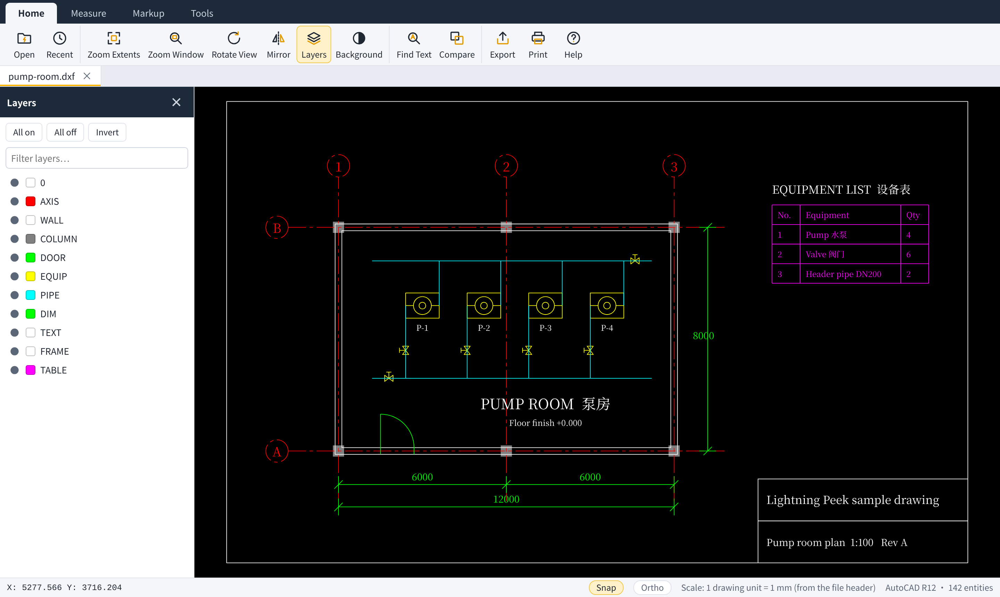
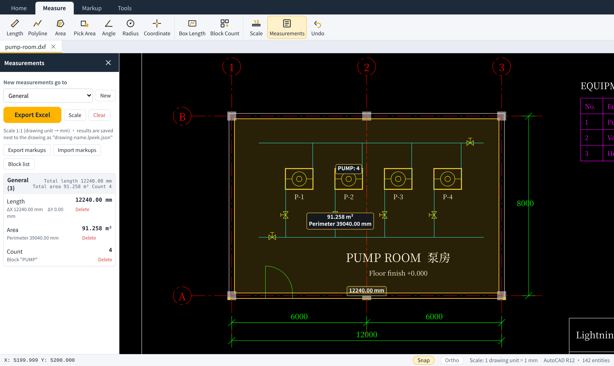
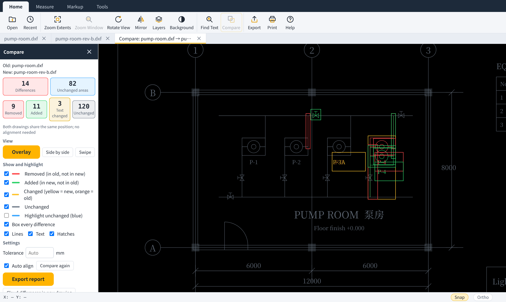

<p align="center">
  
</p>

<h1 align="center">Lightning Peek · 闪电看图</h1>

<p align="center">
  A lightweight DWG/DXF viewer for looking things up, measuring and checking drawings.<br>
  <b>English</b> · <a href="README.zh-CN.md">简体中文</a>
</p>

<p align="center"><b>Current version: v0.2.19 preview</b></p>

Built for people on construction, civil, steel and heritage projects — site engineers, quantity surveyors, document controllers, clients and crews — who open drawings to **look, search, count and check**, not to draft. Lightning Peek opens the drawing without a CAD installation and helps you find, measure and compare what is in it.



## Download

👉 [Download the Windows portable build from Releases](https://github.com/chen-qingfeng/lightning-peek/releases)

This is a preview. It has been checked on a limited set of drawings (see [Supported formats](#supported-formats-and-known-limitations)). Please [report](https://github.com/chen-qingfeng/lightning-peek/issues/new/choose) drawings that do not open or display incorrectly. macOS and Linux builds are not available yet.

## Phone (Android and iOS)

There is no separate phone app. On a computer joined to the same Wi-Fi as the phone, run `npm run phone` in this repository and open the printed address in the phone's browser. Choose a DWG or DXF, drag with one finger, and pinch to zoom. Chrome on Android and Safari on iPhone can both use **Add to Home Screen**. Store packages are not published yet.

## What it does

- **Open drawings.** Drag a DWG or DXF file into the window. Layers, layouts, blocks, hatches, dimensions and Chinese/English text are shown. Drawings are parsed in the background, so the window stays responsive.
- **Find things.** Turn layers on and off, search them, or isolate one. Search all text, including dimension text, in the whole drawing or inside an area, and jump to each result.
- **Rough quantities.** 19 measuring tools: aligned and linear dimensions, polylines, point-to-line distance, arc and curve length, per-segment lengths, batch lengths, stationing at a fixed interval, areas (also with arc segments, rectangles, picked shapes or hatches with islands excluded), side area, angle, radius, circle, coordinates, box length, block counts and identical-shape counts. Results are drawn like CAD dimensions with extension lines and leaders, grouped by category and exported to Excel. The drawing unit (mm or m) is detected from length labels, the file header or survey coordinates, and can be changed.
- **Layouts and references.** Layout viewports with rotation and clipping, embedded Excel tables (OLE), external references loaded from the drawing's folder, and a layout can be exported as a flat model-space DXF.
- **Compare revisions.** Every entity is matched and classified as added, removed or changed text. Unchanged and changed areas are counted, and you can view them overlaid, side by side or with a swipe, then export the list.
- **Mark up without touching the drawing.** Text notes, revision clouds, arrows and numbers are saved in a small file next to the drawing that you can share.





## What it is not

| Not included | Why |
| --- | --- |
| PDF and images (JPG, PNG, …) | Optimized for DWG/DXF only, to stay small |
| Drafting and editing | It is a viewer, not a CAD editor |
| BIM and 3D modelling | It stays 2D and lightweight |
| Precise quantity take-off | It is for quick rough checks, not a replacement for professional estimating software |
| Changing the original drawing | Read-only; text edits can only be saved as a new DXF or DWG |

> Measurements are for quick checks and rough quantities. They depend on how accurately the drawing was drawn and on the scale setting, and do not replace formal quantity take-off.

## Problems it addresses

| Problem | What v0.1.4 does |
| --- | --- |
| Starting a large CAD package just to look at a drawing | Portable app, no installation |
| Messy layers | Layer on/off, search and isolate |
| Piles of text that are hard to read or find | Full-text search with location, optionally inside an area |
| Dense pipes, manholes and footings | Count blocks by name and highlight them; search by text |
| Manual counting and measuring that misses or double-counts | CAD-style dimensions, batch and per-segment lengths, stationing, picked areas, block and shape counts, summarized in Excel |
| Comparing revisions by eye | Drawing comparison with a list of every difference |

The full plan — layer classification, drawing checks, natural-language queries and more — is in [docs/ROADMAP.md](docs/ROADMAP.md).

## Install and first use

1. From [Releases](https://github.com/chen-qingfeng/lightning-peek/releases), download either:
   - **Portable** `LightningPeek-0.1.5-portable.exe`: a single file. Double-click to run; nothing is installed. The first start takes about half a minute to unpack, later starts are immediate.
   - **Installer** `LightningPeek-0.1.5-setup-x64.exe`: installs for the current user (no administrator rights), adds a desktop icon and a Start menu entry, can add Lightning Peek to **Open with** for DWG/DXF, and can be removed from **Settings → Apps**. Your settings and markups are kept in `%APPDATA%\闪电看图`.
   Settings and markups of both are kept in `%APPDATA%\闪电看图`.
2. Start Lightning Peek from the desktop icon or the portable exe. A step-by-step user guide (Chinese) is in [docs/user-guide.zh-CN.md](docs/user-guide.zh-CN.md) and under **Help → Open the user guide**.
   Windows SmartScreen may warn that the app is from an unknown publisher, because the preview is not code-signed. Choose **More info → Run anyway** only if you downloaded it from this repository's Releases page.
3. Click **Open** or drag a `.dwg` / `.dxf` file into the window.
4. The installer can add Lightning Peek to **Open with** for DWG/DXF files.

The interface follows the Windows display language (Chinese or English). You can switch it under **Help → Interface language**.

## Everyday controls

| Action | How |
| --- | --- |
| Zoom | Mouse wheel (zooms at the cursor) |
| Pan | Drag with the left or middle mouse button |
| Whole drawing | `Home`, or double-click the middle button |
| Zoom to a window | `W`, then drag a rectangle |
| Finish a polyline or area | Right-click or `Enter` |
| Leave a tool | `Esc` |
| Object snap / ortho | `F3` / `F8` |
| Undo | `Ctrl+Z` |
| Open · Find · Print | `Ctrl+O` · `Ctrl+F` · `Ctrl+P` |
| Move / copy a markup | Drag it with no tool selected; hold `Ctrl` to copy |

Tool shortcuts (default): `1` Length · `2` Polyline · `3` Area · `4` Pick area · `5` Angle · `6` Radius · `7` Coordinate · `8` Box length · `9` Block count · `T` Text note · `Y` Cloud · `A` Arrow · `R` Rectangle · `L` Line · `N` Number · `E` Erase · `B` Extract table · `X` Edit text · `C` Crop export · `S` Measurements · `G` Layers. All of them can be changed under **Help**.

## Supported formats and known limitations

| Format | Status |
| --- | --- |
| DWG | Read through [LibreDWG](https://www.gnu.org/software/libredwg/). Tested with AutoCAD 2007 format (AC1021) drawings. Other versions depend on LibreDWG and may fail or show missing entities. |
| DXF (ASCII) | Read directly. Tested with R12 and 2007 DXF, UTF-8 and GBK code pages. |
| DXF (binary) | Not supported. |
| Export | PNG, PDF (A3), Excel (measurements, find results, tables, comparison report), DXF (copy with your text edits). DWG cannot be written. |

Known limitations in v0.1.4:

- A Chinese font is bundled (Noto Sans SC, SIL Open Font License). Drawings stay readable on computers that do not have `hztxt.shx`, `gbcbig.shx` or SimSun. If this computer has an SHX font folder selected under Help, those single-line fonts are used instead and the lettering is closer to CAD. Steel-bar symbols (`%%130`–`%%133`) are drawn as grade marks when `tssdeng.shx` / `yjkeng.shx` are absent; search still uses the letters A/B/C/D.
- Custom objects from vertical software (for example TArch walls and doors) are not shown unless the drawing was exported to plain entities (“T3” format). TArch annotation objects are the exception (AutoCAD 2000–2004 DWG): text, multi-line text, elevations, axis labels, drawing names, door/window numbers, leaders, index symbols, arrow notes, tables and dimensions are read from the object data and shown as ordinary text and lines. Walls, columns, stairs and slabs still need the T3 export.
- Wipeouts, 3D solids, regions and multileaders are not shown. External references are shown when the referenced DWG/DXF is found, but you cannot snap to them. Raster images are shown as an outline only.
- OLE objects are shown from the preview stored in the drawing. If the drawing has no preview for an object, only its frame is drawn.
- Line weights are not displayed; complex line types are drawn as simple dashes.
- Opening speed has only been measured on one 380 KB drawing (see [docs/FORMATS.md](docs/FORMATS.md)); there are no systematic performance tests on Windows hardware yet.

The full list of supported entities is in [docs/FORMATS.md](docs/FORMATS.md).

## Privacy and your files

- Lightning Peek does not connect to the internet and collects no data.
- The original drawing is never modified. Text edits are written only to a new DXF or DWG file that you save yourself.
- Measurements and markups are stored next to the drawing as `<drawing>.lpeek.json` once you add one.
- Settings, the recent-files list and the browser cache are stored in the `data` folder next to `LightningPeek.exe`.
- PDF export and printing create a temporary page in the system temp folder and delete it afterwards.

Details: [docs/PRIVACY.md](docs/PRIVACY.md).

## Build from source

Requirements: Node.js 20+, Python 3 with Pillow, `curl`, `unzip`, `zip`, `bash` (Linux or WSL; macOS needs GNU coreutils).

```sh
git clone https://github.com/chen-qingfeng/lightning-peek.git
cd lightning-peek
npm install          # installs Electron for local development
npm start            # runs the app from source
npm test             # unit tests (no extra dependencies)
npm run pack:win     # builds dist/LightningPeek-<version>-win-x64.zip
npm run pack:setup   # builds dist/LightningPeek-<version>-setup-x64.exe (needs NSIS 3)
npm run pack:portable  # builds dist/LightningPeek-<version>-portable.exe (needs NSIS 3)
```

See [docs/BUILDING.md](docs/BUILDING.md) for how the package is assembled and how the project is laid out.

## Roadmap

Next: an installer and code signing, performance tests on Windows hardware, lineweight display and broader DWG version testing.
Later: layer classification, drawing checks (conflicting or missing dimensions, elevation conflicts) and optional AI assistance (natural-language queries, component recognition; off by default).

See [docs/ROADMAP.md](docs/ROADMAP.md) for the full plan and [CHANGELOG.md](CHANGELOG.md) for changes.

## Feedback and contributing

- Bugs and drawings that fail to open: [open an issue](https://github.com/chen-qingfeng/lightning-peek/issues/new/choose). Please do not attach drawings that contain confidential information.
- Pull requests are welcome. Read [CONTRIBUTING.md](CONTRIBUTING.md) first.
- **No CLA.** Contributions are accepted under the project's license, GPL-3.0-or-later (inbound = outbound). You keep the copyright in your work.
- **Where to start:** issues labelled [good first issue](https://github.com/chen-qingfeng/lightning-peek/labels/good%20first%20issue) and [help wanted](https://github.com/chen-qingfeng/lightning-peek/labels/help%20wanted). Please follow the [code of conduct](CODE_OF_CONDUCT.md); report security problems as described in [SECURITY.md](SECURITY.md).

## License and credits

Lightning Peek is free software under the [GNU General Public License v3.0 or later](LICENSE).

It builds on:

- [LibreDWG](https://www.gnu.org/software/libredwg/) (GPL-3.0-or-later) and its WebAssembly build [libredwg-web](https://github.com/mlightcad/libredwg-web) by mlightcad (GPL-3.0) for reading DWG files.
- [Electron](https://www.electronjs.org/) (MIT) and Chromium (various open-source licenses, shipped as `LICENSES.chromium.html`).

See [THIRD-PARTY-NOTICES.md](THIRD-PARTY-NOTICES.md). The sample drawings in `docs/samples` were made for this project.
