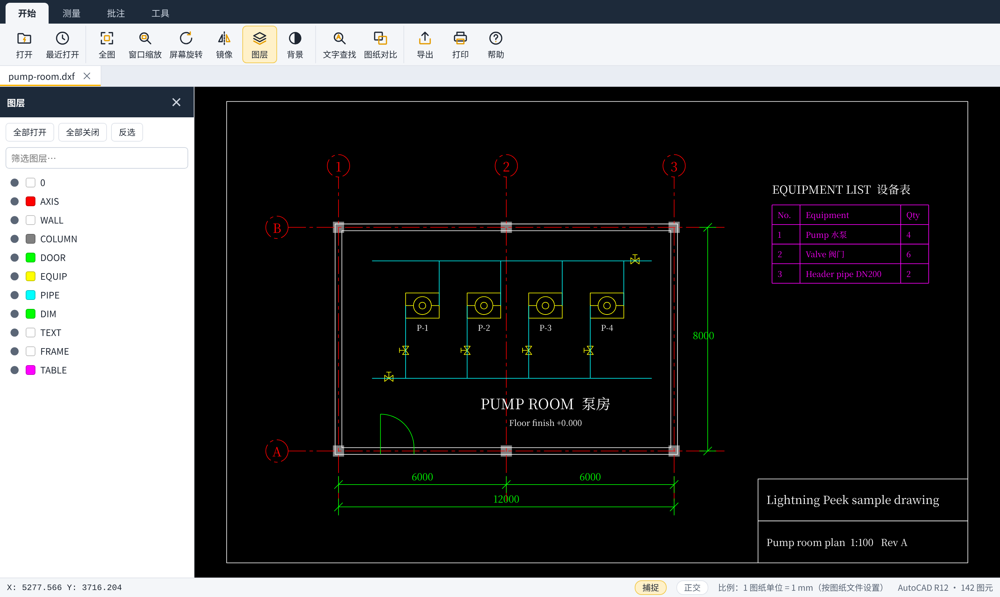
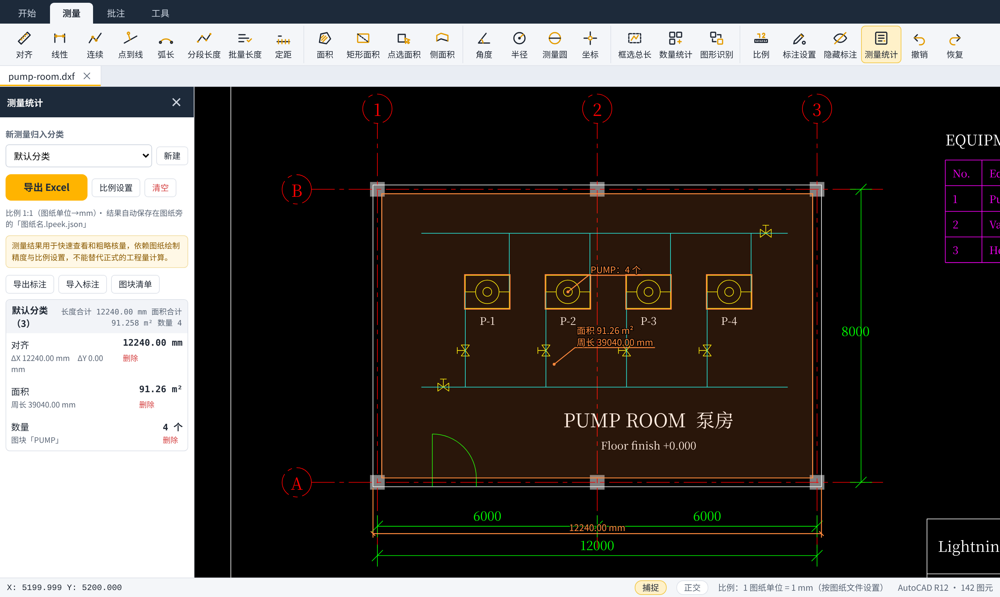
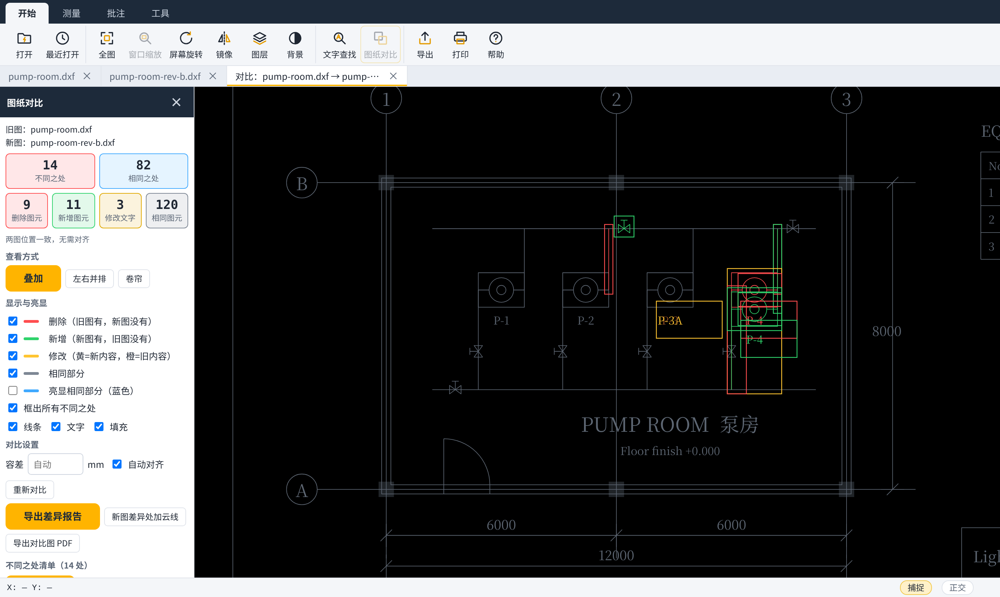

<p align="center">
  
</p>

<h1 align="center">闪电看图 · Lightning Peek</h1>

<p align="center">
  轻量的 CAD 图纸查看工具：打开 DWG / DXF，看图、查图、粗核量。<br>
  <a href="README.md">English</a> · <b>简体中文</b>
</p>

<p align="center"><b>当前版本：v0.2.7 预览版</b></p>

面向建筑、市政、钢构、古建一线的总工、施工员、造价人员、资料员、甲方及班组人员。打开图纸的人，大多不是为了画图，而是为了**看、查、统计、核对**。闪电看图只做这一段：不用安装 CAD，把图纸打开，把里面的东西找出来、量出来、比出来。



## 下载

👉 [从 Releases 下载 Windows 绿色版](https://github.com/chen-qingfeng/lightning-peek/releases)

这是预览版，只用有限的图纸检验过（见[支持格式](#支持格式与已知限制)）。遇到打不开或显示不对的图纸，欢迎[反馈](https://github.com/chen-qingfeng/lightning-peek/issues/new/choose)。暂不提供 macOS 和 Linux 安装包。

## 手机（安卓和苹果）

手机不另做一套程序。电脑和手机连同一个 Wi-Fi，在电脑的仓库目录运行 `npm run phone`，终端会打印一个地址。用手机自带浏览器打开这个地址，点「打开图纸」选择 DWG 或 DXF。单指移动图纸，双指缩放。

安卓用 Chrome 打开后，菜单里选「添加到主屏幕」。苹果用 Safari 打开后，点分享按钮，选「添加到主屏幕」。之后从图标进入，不再显示浏览器地址栏。应用商店安装包还没有。

## 主要功能

- **打开图纸**：拖进窗口即可打开 DWG / DXF，显示图层、布局、图块、填充、标注和中英文文字。图纸在后台解析，界面不会卡住。
- **查图**：图层开关、搜索、隔离（只看某一层）；全文查找文字（含标注文字），可限定在框选范围内，结果逐条定位。
- **粗核量**：19 种测量：对齐、线性、连续、点到线、弧长、分段长度、批量长度、定距（桩号）、面积（含弧线段）、矩形面积、点选面积（自动扣孤岛）、侧面积、角度、半径、测量圆、坐标、框选总长、图块数量、相同图形识别。结果像 CAD 标注一样画出尺寸线、界线和引线，按分类汇总，导出 Excel。图纸单位（毫米或米）根据图上的管长标注、文件设置或测量坐标自动判断，也可以手动改。
- **布局与参照**：布局视口支持旋转和异形裁剪，显示嵌入的 Excel 表格（OLE），自动加载同目录的外部参照，布局可一键转成模型空间的 DXF。
- **新旧图对比**：逐个图元比对，分出新增、删除、文字修改，统计相同之处和不同之处，可叠加、左右并排、卷帘查看，导出变更清单。
- **批注不动原图**：文字、云线、箭头、编号等批注保存在图纸旁的小文件里，可以发给同事。





## 这不是什么

| 不做 | 原因 |
| --- | --- |
| PDF、图片（JPG / PNG 等） | 只为 DWG/DXF 优化，不为兼容更多格式增加体积 |
| CAD 绘图与编辑 | 是查看器，不是编辑器，不与 AutoCAD 竞争 |
| 重型 BIM / 三维建模 | 坚持二维轻量路线 |
| 精确算量 / 替代专业造价软件 | 定位是快速粗核量，不替代广联达、斯维尔等专业软件 |
| 修改原始图纸 | 全程只读；改文字只能另存为新的 DXF 或 DWG |

与同系列项目「迅速看图」分工：闪电看图负责轻量打开、粗提量、图纸核查；迅速看图负责精细建模、精确算量、对接 CASS 与土方等专业提量方向。

> 测量结果用于快速查看和粗略核量，依赖图纸绘制精度与比例设置，不能替代正式的工程量计算。

## 解决什么问题

| 痛点 | v0.1.4 能做的 |
| --- | --- |
| 为看一眼图要启动几百 MB 的 CAD | 免安装绿色版，双击打开 |
| 图层混乱，分不清构件归属 | 图层开关、搜索、隔离 |
| 文字成堆，看不清也找不到 | 全文查找，逐条定位，可限定范围 |
| 管线、检查井、基础密密麻麻，人工翻找 | 按图块名统计数量并框出位置；按文字查找 |
| 长度、面积、个数靠手工框选，易漏易重 | CAD 样式的尺寸标注、批量与分段长度、定距桩号、点选面积、图块与相同图形计数，汇总导出 Excel |
| 设计变更后新旧图对比靠肉眼 | 图纸对比，列出每一处差异 |
| 资料员、甲方、班组不愿装 CAD | 免安装，界面支持中文和英文 |

图层语义归类、图纸校核、自然语言查询等更多规划见 [docs/ROADMAP.md](docs/ROADMAP.md)。

## 安装与首次使用

1. 从 [Releases](https://github.com/chen-qingfeng/lightning-peek/releases) 下载其中一种：
   - **绿色版** `LightningPeek-0.1.5-portable.exe`：只有一个文件，双击就运行，不安装。第一次启动要解压约半分钟，之后秒开。
   - **安装版** `LightningPeek-0.1.5-setup-x64.exe`：按当前用户安装，不需要管理员权限；在桌面和开始菜单放图标，可选加入 DWG/DXF 的「打开方式」；可在「设置 → 应用」里卸载。设置和批注保存在 `%APPDATA%\闪电看图`，卸载时保留。
   两种版本的设置和批注都保存在 `%APPDATA%\闪电看图`。
2. 双击桌面上的「闪电看图」图标或绿色版 exe。详细的操作步骤见[使用说明](docs/user-guide.zh-CN.md)，程序里点「帮助 → 打开使用说明」也能看。
   预览版没有代码签名，Windows SmartScreen 可能提示「未知发布者」。只有确认是从本仓库 Releases 下载的，才点「更多信息 → 仍要运行」。
3. 点「打开」，或把 `.dwg` / `.dxf` 文件拖进窗口。
4. 安装版可以把闪电看图加入 DWG/DXF 的「打开方式」。

界面语言跟随 Windows 显示语言（中文或英文），也可以在「帮助 → 界面语言」里切换。

## 常用操作

| 操作 | 方法 |
| --- | --- |
| 缩放 | 鼠标滚轮（以光标为中心） |
| 平移 | 按住左键或中键拖动 |
| 全图 | `Home`，或双击中键 |
| 窗口缩放 | `W`，再拖出矩形 |
| 结束连续测量、面积 | 右键或 `Enter` |
| 退出当前工具 | `Esc` |
| 对象捕捉 / 正交 | `F3` / `F8` |
| 撤销 | `Ctrl+Z` |
| 打开 · 查找 · 打印 | `Ctrl+O` · `Ctrl+F` · `Ctrl+P` |
| 移动 / 复制标注 | 不选工具时拖动它；按住 `Ctrl` 拖动为复制 |

工具快捷键（默认）：`1` 长度 · `2` 连续 · `3` 面积 · `4` 点选面积 · `5` 角度 · `6` 半径 · `7` 坐标 · `8` 框选总长 · `9` 数量统计 · `T` 文字批注 · `Y` 云线 · `A` 箭头 · `R` 矩形框 · `L` 画线 · `N` 编号 · `E` 删除标记 · `B` 表格提取 · `X` 改文字 · `C` 图纸分割 · `S` 测量统计 · `G` 图层。都可以在「帮助」里修改。

## 支持格式与已知限制

| 格式 | 情况 |
| --- | --- |
| DWG | 通过 [LibreDWG](https://www.gnu.org/software/libredwg/) 读取。用 AutoCAD 2007 格式（AC1021）的图纸测试过。其他版本取决于 LibreDWG，可能打不开或缺少图元。 |
| DXF（文本格式） | 直接读取。测试过 R12 和 2007 版 DXF，UTF-8 与 GBK 编码。 |
| DXF（二进制） | 不支持。 |
| 导出 | PNG、PDF（A3）、Excel（测量结果、查找结果、表格、对比报告）、DXF（含文字修改的副本）。不能写 DWG。 |

v0.1.4 的已知限制：

- 软件自带中文字体（Noto Sans SC，SIL 开源字体许可证）。别人的电脑没有 `hztxt.shx`、`gbcbig.shx` 或宋体，字也看得到。若在「帮助」里选了本机 SHX 字体文件夹，则优先用那些单线字，更接近 CAD。钢筋符号（`%%130`–`%%133`）在没有 `tssdeng.shx`、`yjkeng.shx` 时按等级画成不同形状；搜索和导出仍用等级字母。
- 天正等专业软件的自定义对象（墙、门窗等）不显示；导出为普通图元的「T3」格式图纸可以正常显示。天正的标注类对象例外（AutoCAD 2000–2004 格式的 DWG）：单行/多行文字、标高、轴号、图名、门窗编号、引出标注、索引符号、箭头引注、表格、尺寸标注，直接从对象数据里读出，按普通文字和线条显示。墙、柱、楼梯、楼板仍需导出 T3。
- 不显示遮罩、三维实体、面域和多重引线。外部参照在找到被参照的 DWG/DXF 时显示，但不能捕捉。光栅图片只画外框。
- OLE 对象按图纸里保存的预览图显示；图纸没存预览的对象只画外框。
- 不显示线宽，复杂线型按简单虚线绘制。
- 打开速度只在一张 380 KB 的图纸上测过（见 [docs/FORMATS.md](docs/FORMATS.md)），还没有在 Windows 真机上做系统的性能测试。

完整的图元支持清单见 [docs/FORMATS.md](docs/FORMATS.md)。

## 隐私与文件

- 闪电看图不联网，不收集任何数据。
- 不会修改原图纸。改文字只会写进你另存的新 DXF / DWG 文件。
- 添加测量或批注后，会保存在图纸旁的 `图纸名.lpeek.json`。
- 设置、最近打开记录和浏览器缓存保存在 `LightningPeek.exe` 旁的 `data` 文件夹。
- 导出 PDF 和打印时会在系统临时文件夹生成临时页面，用完即删。

详见 [docs/PRIVACY.md](docs/PRIVACY.md)。

## 从源码构建

需要：Node.js 20+、带 Pillow 的 Python 3、`curl`、`unzip`、`zip`、`bash`（Linux 或 WSL；macOS 需另装 GNU coreutils）。

```sh
git clone https://github.com/chen-qingfeng/lightning-peek.git
cd lightning-peek
npm install          # 安装开发用的 Electron
npm start            # 从源码运行
npm test             # 单元测试（无额外依赖）
npm run pack:win     # 生成 dist/LightningPeek-<版本>-win-x64.zip
npm run pack:setup   # 生成 dist/LightningPeek-<版本>-setup-x64.exe 安装程序（需要 NSIS 3）
npm run pack:portable  # 生成 dist/LightningPeek-<版本>-portable.exe 单文件绿色版（需要 NSIS 3）
```

打包过程和目录结构见 [docs/BUILDING.md](docs/BUILDING.md)。

## 路线图

近期：安装程序与代码签名、Windows 真机性能测试、线宽显示、更多 DWG 版本的兼容性测试。
之后：图层语义归类、图纸校核（标注冲突、缺失标注、标高矛盾）、可选的 AI 辅助（自然语言查询、构件识别，默认关闭）。

完整规划与状态见 [docs/ROADMAP.md](docs/ROADMAP.md)，版本变化见 [CHANGELOG.md](CHANGELOG.md)。

## 反馈与参与

- 报告问题、打不开的图纸：[提交 Issue](https://github.com/chen-qingfeng/lightning-peek/issues/new/choose)。请不要上传含保密信息的图纸。
- 欢迎提交 Pull Request，请先阅读 [CONTRIBUTING.md](CONTRIBUTING.md)。
- **不签 CLA**：贡献按本项目的许可证 GPL-3.0-or-later 接收（贡献进来和发布出去用同一个许可证），版权仍归你本人。
- **从哪里开始**：看标了 [good first issue](https://github.com/chen-qingfeng/lightning-peek/labels/good%20first%20issue) 和 [help wanted](https://github.com/chen-qingfeng/lightning-peek/labels/help%20wanted) 的 Issue。请遵守[行为准则](CODE_OF_CONDUCT.md)；安全问题按 [SECURITY.md](SECURITY.md) 私下报告。

## 许可证与致谢

闪电看图是自由软件，采用 [GNU 通用公共许可证 第 3 版或更高版本](LICENSE)。

依赖的开源项目：

- [LibreDWG](https://www.gnu.org/software/libredwg/)（GPL-3.0-or-later），以及 mlightcad 的 WebAssembly 版本 [libredwg-web](https://github.com/mlightcad/libredwg-web)（GPL-3.0），用于读取 DWG。
- [Electron](https://www.electronjs.org/)（MIT）和 Chromium（多种开源许可，随包附带 `LICENSES.chromium.html`）。

详见 [THIRD-PARTY-NOTICES.md](THIRD-PARTY-NOTICES.md)。`docs/samples` 里的示例图纸为本项目自绘。
