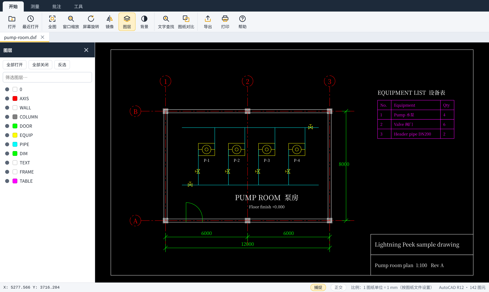
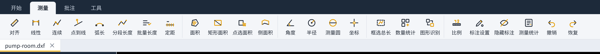
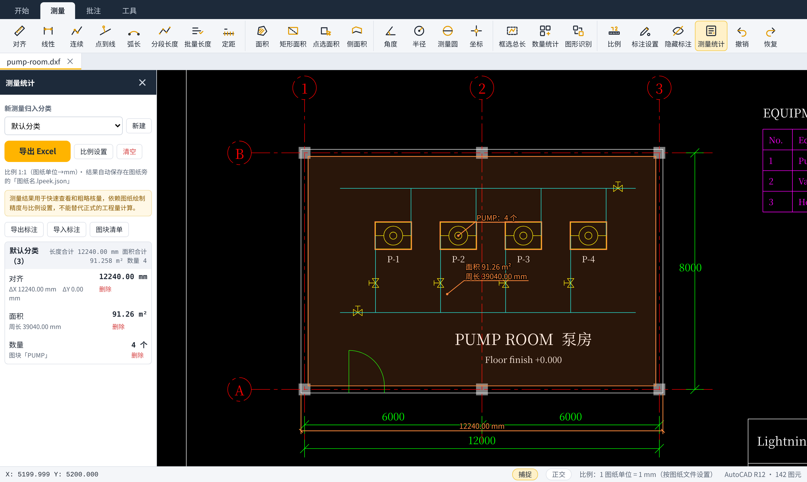
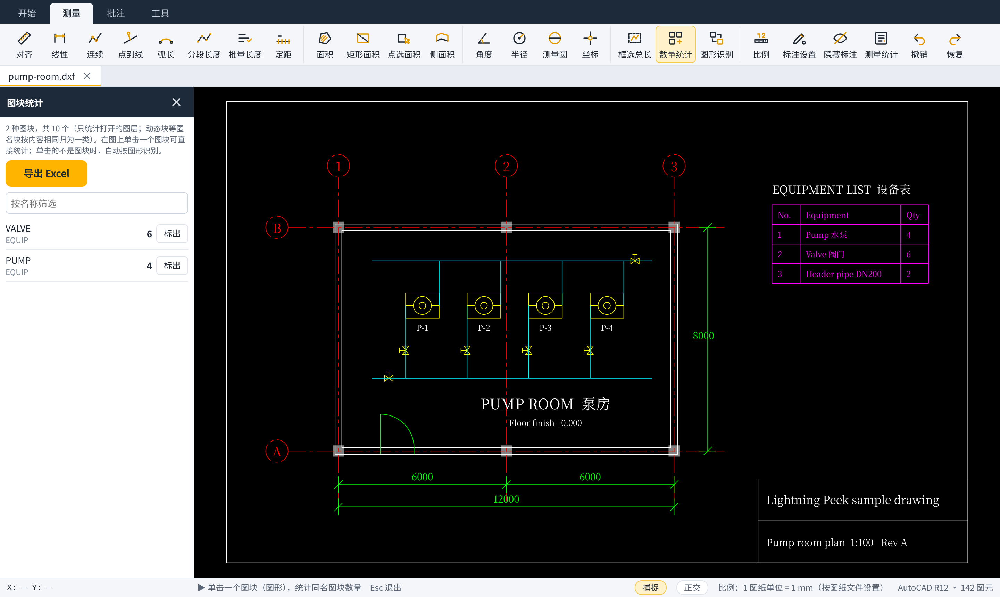
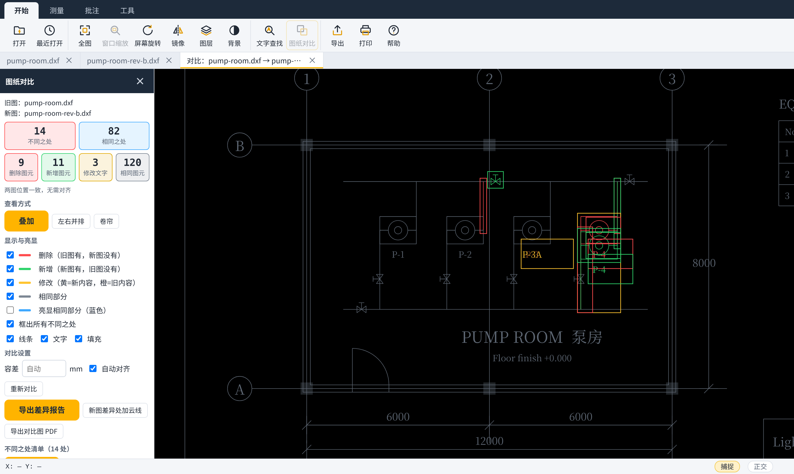
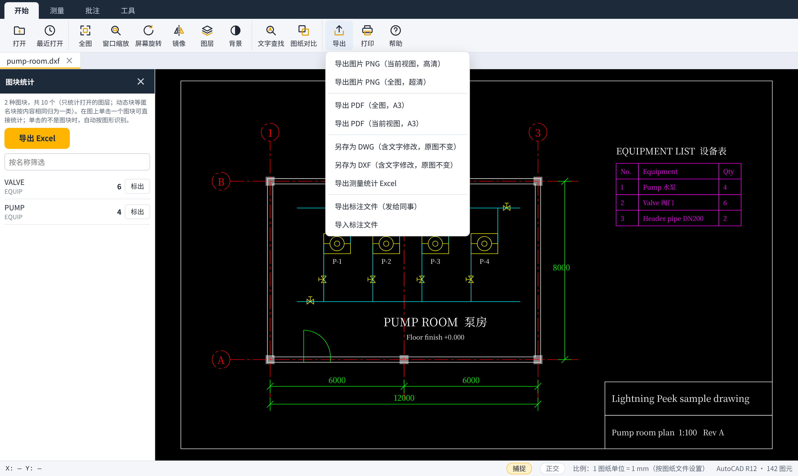

# 闪电看图 使用说明

适用版本：v0.1.5 预览版　|　系统：Windows 10 / 11（64 位）

闪电看图用来**看 CAD 图纸、量尺寸、数数量、对比新旧图**，不用安装 AutoCAD。它只读图纸，不会改动你的原图。

> 测量结果用于快速查看和粗略核量，取决于图纸画得准不准和比例设得对不对，不能代替正式的工程量计算。

---

## 1. 下载哪一个

到 [Releases 页面](https://github.com/chen-qingfeng/lightning-peek/releases) 下载，二选一：

| 文件 | 适合谁 | 说明 |
| --- | --- | --- |
| `LightningPeek-0.1.5-portable.exe`（绿色版） | 不想安装、想放 U 盘或桌面直接用 | 只有这一个文件，双击就运行。**不安装、不写注册表、不建快捷方式** |
| `LightningPeek-0.1.5-setup-x64.exe`（安装版） | 想在桌面和开始菜单有图标、以后右键图纸就能打开 | 正常安装，可在「设置 → 应用」里卸载 |

两种版本功能完全一样，保存的设置和批注也互通。

## 2. 第一次打开

1. 双击下载的 exe。
2. Windows 可能弹出蓝色提示「Windows 已保护你的电脑」。这是因为预览版还没有购买代码签名证书，不代表有病毒。确认文件是从上面的 Releases 页面下载的，点 **更多信息 → 仍要运行**。
3. **绿色版第一次运行**会显示「正在准备程序」，大约半分钟，之后再打开就是秒开。
4. **安装版**按提示点「下一步」即可。默认装在你自己的用户目录下，不需要管理员权限；可以选择是否在桌面放图标、是否加入图纸的「打开方式」。

## 3. 打开图纸

- 点左上角 **打开**，或直接把 `.dwg` / `.dxf` 文件**拖进窗口**。
- 可以同时开多张图，上方是图纸标签，点标签切换。
- 打开完成后，底部提示会告诉你图元数量、用时，以及**测量单位**（例如「1 图纸单位 = 1000 mm（按测量坐标判断）」）。

## 4. 看图

| 想做什么 | 怎么做 |
| --- | --- |
| 放大缩小 | 滚动鼠标滚轮 |
| 移动图纸 | 按住鼠标左键（或中键）拖动 |
| 回到全图 | 点 **全图**，或按 `Home`，或双击鼠标中键 |
| 放大一块区域 | 点 **窗口缩放**，拖出一个框 |
| 看布局（出图的图纸） | 点窗口底部的布局标签 |
| 图纸方向不对 | **屏幕旋转**（每次 90°）、**镜像** |
| 只看某些图层 | **图层**：点图层名开关；点「隔离」只看这一层，「恢复显示」还原 |
| 找文字 | **文字查找**（`Ctrl+F`），点结果自动定位，可导出 Excel |
| 黑底 / 白底 | **背景** |

图纸里嵌入的 Excel 工程量表会直接显示；在 **工具 → 嵌入表格** 里可以定位，或另存成 Excel。图纸引用的外部参照会自动从同一文件夹加载，在 **工具 → 外部参照** 里查看。

## 5. 测量

### 先确认比例

看一眼窗口右下角的「比例：1 图纸单位 = … mm」。

- 闪电看图会自动判断图纸是**毫米**画的还是**米**画的（依据图上的「L=」管长标注、文件设置或测量坐标）。
- 如果不对，点状态栏的比例文字（或 **测量 → 比例**）修改；也可以选「在图上点两点，输入实际长度」来校准。

### 测量工具

切到 **测量** 标签：

| 工具 | 怎么用 |
| --- | --- |
| 对齐 | 点两点，再点一下放置尺寸线（右键直接完成） |
| 线性 | 点两点，移动鼠标决定量水平还是竖直，再点一下放置 |
| 连续 | 依次点多个点，右键或回车结束，得到总长和每段长度 |
| 点到线 | 先点一条直线，再点一个点，得到垂直距离 |
| 弧长 | 单击圆弧、圆或任意曲线 |
| 分段长度 | 单击一条多段线，每段长度都标出来 |
| 批量长度 | 逐条单击要统计的线（再点一次取消），右键完成，得到合计 |
| 定距 | 单击一条线，输入间距，按桩号（如 K0+020）标出各点 |
| 面积 | 依次点顶点，右键结束；按 `A` 切换成弧线段 |
| 矩形面积 | 点两个对角 |
| 点选面积 | 在封闭图形或填充里单击，自动扣除里面的孤岛 |
| 侧面积 | 点取路线后输入高度，得到 长 × 高 |
| 角度 / 半径 / 测量圆 / 坐标 | 按提示单击 |
| 框选总长 | 框住一片区域，统计框内所有线的总长 |

小技巧：

- 量的时候会自动**捕捉**端点、中点、圆心（青色小标记），`F3` 开关；`F8` 开关**正交**。
- 测量结果的文字可以**拖动**换位置；不选工具时拖动测量本身可以移动，按住 `Ctrl` 拖动是复制。
- `Ctrl+Z` 撤销，`Ctrl+Y` 恢复；`Esc` 退出当前工具。
- **标注设置**里可以改文字大小、颜色、小数位数、尺寸线端头（斜线或箭头）；**隐藏标注**可以临时全部隐藏。

### 测量统计

点 **测量统计**（`S`）打开右侧面板：所有结果按分类汇总，点一条定位，双击可改备注、分类、展开高度、面积偏移。点 **导出 Excel** 得到表格。

所有测量和批注自动保存在图纸旁边的「图纸名.lpeek.json」小文件里，下次打开还在；把这个小文件和图纸一起发给同事，对方也能看到。

## 6. 数数量

点 **测量 → 数量统计**，右边会**自动列出这张图里所有图块和数量**（只统计打开的图层）：

- 点某一行的 **标出**，图上会框出它的全部位置，并记入测量统计。
- 在图上**单击一个图块**，直接统计同名图块的数量。
- 动态块（名字是 *U 开头的匿名块）按内容相同归为一类，显示为「匿名块 1」「匿名块 2」……
- 如果单击的符号**不是图块**（是散开的线和圆），会自动改用**图形识别**，按点中的图形数出图上相同的图形。也可以用 **图形识别** 框选一个样板来数。图形识别只认平移后的相同图形，旋转或镜像过的不算。
- 面板上的 **导出 Excel** 得到图块清单。

## 7. 新旧图对比

1. 先打开旧图。
2. 点 **图纸对比 → 选择新图纸开始对比**。
3. 红色是删掉的，绿色是新增的，黄色是改过的（文字修改会显示「旧 → 新」）。右侧列出每一处差异，点击定位。
4. 可以切换叠加、左右并排、卷帘查看；能导出变更清单 Excel，或在新图上画修订云线。

两张图整体挪了位置也能自动对齐。

## 8. 批注

**批注** 标签里有：文字批注、云线、箭头、矩形框、画线、编号。用 **删除标记** 单击删除。批注不会改动原图。

## 9. 导出、打印、另存

点 **导出**：

| 选项 | 说明 |
| --- | --- |
| 导出图片 PNG | 当前视图或全图 |
| 导出 PDF | A3 纸，全图或当前视图 |
| 另存为 DWG | 生成新的 DWG（含你改过的文字），原图不变。需要电脑上装有免费的 **ODA File Converter**；没装时会提示下载地址，装好后自动找到。可选 AutoCAD 2000～2018 版本 |
| 另存为 DXF | 生成新的 DXF（含改过的文字），任何 CAD 都能打开，不需要额外软件 |
| 导出测量统计 Excel | 全部测量结果 |
| 导出 / 导入标注文件 | 把测量和批注发给同事，或导入同事的 |

**工具** 标签里还有：表格提取（框住图上的表格导出 Excel）、改文字、图纸分割（框选一块单独导出）、布局转模型（把布局连同视口内容转成一张 DXF）。

**打印**（`Ctrl+P`）按 A3 打印当前视图。

## 10. 常用快捷键

| 按键 | 作用 | 按键 | 作用 |
| --- | --- | --- | --- |
| `Ctrl+O` | 打开 | `Home` | 全图 |
| `Ctrl+F` | 文字查找 | `W` | 窗口缩放 |
| `Ctrl+Z` / `Ctrl+Y` | 撤销 / 恢复 | `G` | 图层 |
| `Ctrl+P` | 打印 | `S` | 测量统计 |
| `1`～`9` | 常用测量工具 | `F3` / `F8` | 捕捉 / 正交 |
| `Esc` | 退出当前工具 | `Delete` | 删除鼠标下的测量或批注 |

在 **帮助** 里可以查看和修改全部快捷键，也可以切换中文 / English。

**CAD 字体**也在帮助里。软件已经自带一套中文字体，换一台没有 `hztxt.shx`、`gbcbig.shx` 的电脑，字也看得到，只是字形是黑体，不是 CAD 单线字。如果这台电脑有字体文件夹，可以点「选择字体文件夹」用真正的 `.shx`；这个选择只影响这一台电脑。点「复制到软件里」会把这些字体抄进软件自己的字体库。

## 11. 常见问题

**打开很慢？** 很大的 DWG（几十 MB）第一次解析需要十几秒，窗口会显示进度，不会卡死。

**量出来的数差了 1000 倍？** 比例不对。点右下角的比例文字改成正确的单位，或用「点两点校准」。

**有些东西没显示？** 打开时底部会提示哪些对象暂不显示（例如天正的专业对象、多重引线）。天正的文字、标高、轴号、图名、门窗编号、引出标注、索引符号、箭头引注、表格和尺寸标注会直接显示；墙、柱、楼梯、楼板等天正对象仍需在天正里「导出 T3」后再打开。

**另存 DWG 提示要 ODA File Converter？** 这是开放设计联盟提供的免费工具，本软件不能自带。按提示下载安装一次即可；不想装的话，选「另存为 DXF」，AutoCAD 等都能打开。

**会不会改坏我的图纸？** 不会。闪电看图只读原图；改文字、另存都是生成新文件。

**字是方框、问号，或者和 CAD 里不一样？** 软件自带的中文字体能保证字认得出。若要和 CAD 里的单线字一致，打开「帮助」，选择放有 `hztxt.shx`、`gbcbig.shx` 的文件夹，再重新打开这张图。别人的电脑没有这个文件夹时，仍然用自带字体显示。

**会不会上传我的图纸？** 不会。闪电看图不联网（只有你主动点「打开下载页面」时才会打开浏览器），不收集任何数据。

## 12. 数据保存在哪里、怎么卸载

| 内容 | 位置 |
| --- | --- |
| 测量和批注 | 图纸旁边的「图纸名.lpeek.json」 |
| 设置、最近打开记录 | `%APPDATA%\闪电看图` |
| 绿色版运行时解出的程序 | `%LOCALAPPDATA%\LightningPeek` |

- **绿色版**：删掉 exe 即可；想彻底清理，再删上表后两个文件夹。
- **安装版**：在「设置 → 应用」里找到「闪电看图」卸载，桌面和开始菜单图标会一起删除；设置保留在 `%APPDATA%\闪电看图`，不需要可以手动删除。

## 13. 反馈问题

到 [Issues](https://github.com/chen-qingfeng/lightning-peek/issues) 提交，写明版本、图纸的 DWG 版本、哪里不对，最好附截图。**请不要上传含客户信息的图纸。**
